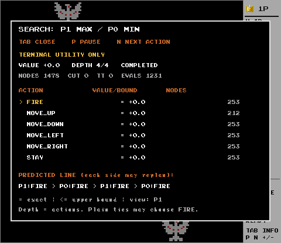
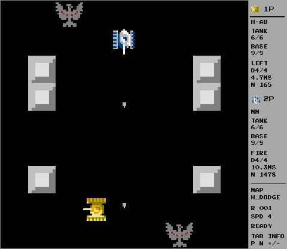

# Mô hình đối kháng và cách quan sát trên UI

## Mô hình zero-sum cho trận hai AI

- **Người chơi:** P0 và P1, thông tin đầy đủ, không có yếu tố ngẫu nhiên trong luật.
- **Trạng thái:** kích thước map, gạch và HP, thép, hai xe (ô, hướng, HP), hai căn cứ,
  đạn (ô, hướng, chủ sở hữu), người tới lượt, số vòng và giới hạn vòng.
- **Hành động:** tập hợp các nước hợp lệ từ MOVE_UP/DOWN/LEFT/RIGHT, FIRE, STAY.
  Một MOVE vừa xoay vừa đi một ô nếu trống; khi bị chặn có thể chỉ xoay.
- **Chuyển trạng thái:** thực hiện một hành động, đổi lượt. Sau P1, mọi đạn tiến
  tối đa 3 ô, kiểm tra va chạm từng ô và dừng tại va chạm. Sát thương mỗi hit = 1;
  HP xe/căn cứ/gạch ban đầu = 6/9/3. Thép không phá được. Có sát thương phe mình.
  Đạn gặp nhau hoặc đổi chỗ trong một bước sẽ triệt tiêu theo luật engine hiện có.
- **Kết thúc:** một bên mất xe hoặc căn cứ thì thua; cả hai cùng bị hạ là hòa.
  Giới hạn 300 vòng là quy tắc bảo đảm trận hữu hạn của ứng dụng; hết vòng là hòa
  nếu không có bên bị hạ. Kết quả bị phá hủy ở vòng cuối được ưu tiên trước hòa.
- **Utility:** +10000 nếu thắng, -10000 nếu thua, 0 nếu hòa, theo góc nhìn người
  đang tìm kiếm. Đổi góc nhìn thì đổi dấu. Thắng sớm/thua muộn được ưu tiên bằng
  độ sâu còn lại. Thời gian còn lại trước hòa nằm trong khóa bảng chuyển vị.

Minimax lấy MAX khi tới lượt bên đang tìm kiếm, MIN ở lượt đối thủ.
Alpha-Beta tính cùng giá trị với cùng evaluator/độ sâu nhưng có thể bỏ nhánh.
Nếu nhiều hành động đồng điểm, các hành động tối ưu có thể khác nhau theo thứ tự xét.
Bảng chuyển vị lưu rõ exact/lower/upper bound và độ sâu; không lẫn khóa này với
khóa phát hiện lặp (khóa lặp bỏ thời gian để nhận ra cùng vị trí quay lại).

## Bốn cấu hình giữ đúng bản chất

| Cấu hình | Trạng thái chưa kết thúc ở giới hạn độ sâu | Cắt tỉa |
| --- | --- | --- |
| MINIMAX | 0 | Không |
| ALPHA-BETA | 0 | Có |
| HEURISTIC MINIMAX | HP + đường đi + hướng bắn + đạn | Không |
| HEURISTIC ALPHA-BETA | Cùng heuristic trên | Có |

Heuristic giữ trọng số HP căn cứ 100, HP xe 80, đường đi 10, hướng bắn 30, đạn 60.
Dijkstra cung cấp ước lượng đường đi có chi phí phá gạch. Tầm bắn/đạn là ước lượng,
không bảo đảm dự đoán đúng mọi chuyển động tương lai của đối thủ. Điểm chưa kết
thúc bị giới hạn trong [-9900,9900] để thắng/thua luôn quan trọng hơn.

**Không cài luật bí mật bắt bản plain đi vòng, né đạn hay bắn trúng mục tiêu.**
Khi chưa nhìn thấy kết cục, nhiều nhánh plain cùng 0 điểm và FIRE thường thắng
phá hòa. Đây là baseline terminal-only hợp lệ, không phải game bị mất điều khiển.
Mặc định phạt lặp = 0 cho cả bốn cấu hình để đối chiếu cùng hàm mục tiêu zero-sum.
Tham số phạt lặp cũ vẫn có trong API cho thử nghiệm riêng, không bật trong UI/benchmark chuẩn.

## Xem trực tiếp quyết định trên UI

Bố cục classic và hoạt ảnh đạn: [CLASSIC_UI.md](CLASSIC_UI.md).
Thanh bên viết 1P/2P tương ứng P0/P1; Tab giữ bảng phân tích đầy đủ.



1. Trong setup chọn hai thuật toán, độ sâu và map.
2. **B** đổi ngân sách chung: 60 / 120 / 250 ms mỗi hành động hoặc FULL DEPTH.
   FULL DEPTH dùng tìm kiếm đủ độ sâu được chọn; cửa sổ vẫn vẽ bằng luồng chính.
3. Trong trận: **P** dừng/tiếp tục, **N** thực hiện đúng một hành động AI.
   Kết quả đang tính xong được giữ lại khi dừng, chỉ áp dụng khi tiếp tục/đi từng lượt.
4. **Tab** mở/đóng bảng phân tích của hành động vừa áp dụng. Bảng có MAX/MIN theo
   góc nhìn người chọn, điểm, độ sâu thực tế, số nút, cắt tỉa, TT và số lần đánh giá.
5. Mỗi dòng hành động: `=` là điểm chính xác; `<=` là cận trên do Alpha-Beta cắt
   tỉa, **không phải điểm chính xác của nhánh đó**. Dấu `>` đánh dấu nước đã chọn.
6. **PREDICTED LINE** là chuỗi nước dự đoán trong cây, không ép đối thủ thực hiện
   chuỗi đó. Mỗi bên sẽ tìm kiếm lại khi tới lượt. Một depth là một hành động.
7. **V** bật/tắt nét đứt (mặc định tắt trong giao diện classic) chỉ hướng bắn hiện tại tới vật cản đầu tiên; nét liền là
   chuyển động vừa xảy ra. Các đường này không thay thế việc mô phỏng đạn.
8. `+/-` thay tốc độ trình diễn, **R** chơi lại, **Esc** về setup.



Độ sâu `3/4` có nghĩa tìm xong 3 trên 4 hành động yêu cầu. Ngân sách thời gian là
**soft deadline**: kiểm tra trước mỗi nút và mỗi đánh giá, có thể vượt một lần
đánh giá đang chạy; không hứa giới hạn cứng với mã Python hay AI bên ngoài.
Nếu không hoàn tất được depth 1, bảng ghi FALLBACK và không hiển thị kết quả
nhánh dở dang như kết quả đã hoàn tất. Tổng số nút/evals/thời gian tính cả vòng
lặp bị ngắt; các dòng hành động và chuỗi dự đoán thuộc lần tìm kiếm hoàn tất cuối.

## Tối ưu đang dùng

- Alpha-Beta cắt tỉa và bảng chuyển vị với loại cận đúng.
- Sắp xếp hành động gốc, ưu tiên nước tốt của lần tìm sâu trước.
- Tìm sâu dần khi có ngân sách thời gian, giữ kết quả hoàn tất cuối.
- SearchAgent tái sử dụng evaluator/cache Dijkstra giữa các lượt; TT được xóa mỗi lượt.
- Cache cấu trúc tường; sao chép trạng thái để thử nước không làm đổi trận thật.
- Đếm mọi lần gọi evaluator: `evals = order_evals + leaf_evals`; không giấu chi phí
  sắp xếp vào ngoài thống kê. Generated đếm các trạng thái sinh trong tìm kiếm và
  sắp xếp, không đếm thao tác đọc lại chuỗi dự đoán phục vụ UI.

## Tích hợp AI của nhóm khác

Đặt file `.py` trong `agents/` hoặc `task2/`, nhấn **F5** ở setup.
Có thể dùng `create_agent(player_id)` trả đối tượng có `act`, hoặc hàm cấp module
`choose_action(state)` / `act(state)`. Ví dụ dùng API có ngân sách:

```python
from game import Action

class MyAgent:
    def reset(self, player):
        self.player = player

    def act(self, state, time_limit_ms=None, history=None):
        # Thay bằng thuật toán của nhóm; luôn trả một nước hợp lệ.
        return Action.STAY, {"algorithm": "my-group"}

def create_agent(player_id):
    bot = MyAgent()
    bot.reset(player_id)
    return bot
```

Loader chuyển tiếp time_limit_ms/history nếu hàm chấp nhận, gọi reset nếu có,
chấp nhận Action, số enum hoặc tên action. Engine kiểm tra lại tính hợp lệ.
AI ngoài chạy chung luật và cùng map. Tác giả AI ngoài cần tự tuân thủ ngân sách;
luồng UI không thể cưỡng bức ngắt một hàm bên ngoài tùy ý.

## Kiểm chứng và số liệu

```sh
python -m unittest discover -s tests -p "test_*.py"
python tests/smoke_modes.py
python tests/smoke_analysis.py
```

Các kiểm thử gồm cây tính tay max(min(3,5),min(2,9))=3; vét cạn độc lập trên các
map, cả hai góc nhìn; kiểm tra cận Alpha-Beta và chuỗi dự đoán; trạng thái không
bị sửa; khóa thời gian; timeout ở bước ordering; sát thương/va chạm; hòa; API AI ngoài.
Số liệu tham khảo, lệnh chạy lại và giới hạn diễn giải: [experiments/README.md](experiments/README.md).

Chế độ một người đấu bốn NPC vẫn là phần mở rộng dùng bản chiếu hai xe, như đã
nêu trong AI_BATTLE_README.md. Mô hình zero-sum và các phép đối chiếu ở tài liệu
này dành cho **hai AI đấu nhau**.
