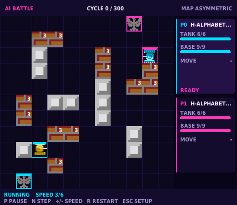

# ASYMMETRIC — hai vị trí xuất phát lệch nhau

Trong **AI BATTLE → MAP**, chọn **ASYMMETRIC** rồi Enter.


Map 11 × 11 có các cụm tường gạch, thép và lối mở không đối xứng theo trục ngang,
trục dọc hay phép quay 180 độ. Không có đạn đặt sẵn lúc bắt đầu.

| Thành phần | Vị trí `(hàng, cột)`, tính từ 0 | Hướng ban đầu |
| --- | --- | --- |
| Xe P0 | `(8, 2)` — khu vực dưới trái | Phải |
| Xe P1 | `(2, 9)` — khu vực trên phải | Trái |
| Căn cứ P0 | `(10, 1)` | — |
| Căn cứ P1 | `(0, 8)` | — |

Hai xe khác cả hàng lẫn cột, không nằm trên đường bắn thẳng vào nhau.
Hai bên đều có 6 HP xe, 9 HP căn cứ và nhiều ô trống để di chuyển ngay.
Cả hai đều có đường đến căn cứ đối phương mà không bắt buộc phá tường.

```text
........b..
..WW.......
..S...W..1.
..S...W..W.
......S.WW.
.W.SS.S....
.W....S....
...WW...S..
.S0.....S..
...W.......
.a.........
```

`.` ô trống; `W` gạch; `S` thép; `0`/`1` xe P0/P1; `a`/`b` căn cứ P0/P1.

## Quan sát và so sánh

Giữ cùng độ sâu, ví dụ 4, rồi quan sát hướng tiếp cận và xử lý vật cản.
Ở trạng thái ban đầu, tìm đủ độ sâu 4:

- MINIMAX / ALPHA-BETA chọn FIRE ở cả hai vị trí.
- HEURISTIC MINIMAX / HEURISTIC ALPHA-BETA: P0 chọn MOVE_UP, P1 chọn MOVE_LEFT.

Map cố ý bất đối xứng nên không bảo đảm hai vị trí có lợi thế ngang nhau.
Ước lượng đường đến căn cứ đối thủ ban đầu là 14 cho P0 và 16 cho P1.
Để so sánh hai thuật toán, chơi hai lượt và đổi thuật toán giữa P0/P1;
đừng quy mọi khác biệt về kết quả thắng/thua cho riêng thuật toán.
Thuật toán, trọng số và luật di chuyển/bắn được giữ nguyên.

```sh
python task2/benchmark.py --scenarios asymmetric --players both --depths 2 4 --repeats 3 --output asymmetric_results.csv --summary asymmetric_summary.csv
python -m unittest discover -s tests -p "test_*.py"
```
