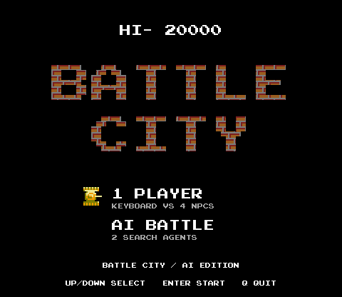
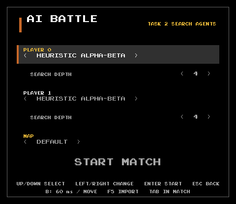
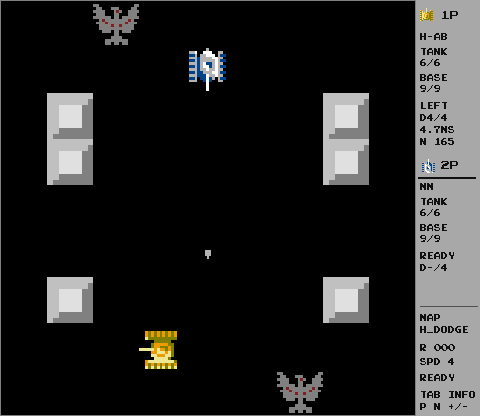

# Giao diện cổ điển và hoạt ảnh đạn

Bản cập nhật này chỉ sửa trình bày. Các file `search.py`, `heuristics.py`, `game.py`, `agent.py` trong `task2/` và
`arena.py` giữ nguyên từng byte so với commit `1481095`: thuật toán, evaluator,
ngân sách tìm kiếm, HP, tốc độ 3 ô/vòng, va chạm và map không thay đổi.

## Giao diện



Nền đen, chữ pixel, tiêu đề ghép gạch, con trỏ xe tăng vàng, sprite gốc vàng/trắng
và thanh trạng thái xám 64 pixel. Bàn chơi chiếm vùng 416 × 416 trong cửa sổ
480 × 416, như bố cục cũ. Mặc định bỏ lưới, viền neon và đường ngắm.
Trên thanh bên, **1P là P0**, **2P là P1**; tên thuật toán được viết gọn:
MM, AB, H-MM, H-AB. D là độ sâu đạt được/yêu cầu, N là số nút.



## Đạn đi mượt hơn



- Game vẫn theo lượt: P0 rồi P1, sau đó đạn tiến tối đa 3 ô.
- Bộ vẽ chạy với mục tiêu 60 FPS, nội suy theo thời gian thực giữa các vị trí.
- Đạn mới hiện ở đầu nòng và chờ đúng pha đạn; không bay trước luật game.
- Đạn bị xóa khỏi trạng thái vì trúng tường/xe/căn cứ vẫn có quãng bay hiển thị
  tới điểm tiếp xúc rồi mới biến mất và phát tia nổ.
- Đạn đi ngược chiều gặp nhau ở cùng điểm trên hình, kể cả trường hợp đổi ô.
- Gạch, HP xe và HP căn cứ được vẽ theo các ảnh trung gian của pha đạn để tránh
  hiện tường vỡ trước khi viên đạn chạm tới. Các ảnh này là bản sao chỉ dùng để vẽ.
- UI hoàn tất hoạt ảnh pha hiện tại rồi mới áp dụng lượt tiếp theo; bỏ khoảng
  nghỉ thừa giữa hai hành động AI. Tốc độ hiển thị được chuẩn hóa theo kích thước ô.
- Thông báo thắng/thua xuất hiện sau khi thấy va chạm kết thúc trận.

GIF là 5 giây hình được chụp từ bộ vẽ thật, mã hóa 30 FPS để xem trên GitHub;
không phải thay đổi tốc độ vật lý của game. FPS thực tế tùy khả năng máy.

## Điều khiển giữ nguyên

- `+/-`: tốc độ phát hoạt ảnh, không đổi số ô đạn đi trong một vòng.
- `P`: dừng các lượt mới; hoạt ảnh của lượt đã áp dụng được phát hết.
- `N`: áp dụng một hành động AI, chờ pha đang phát kết thúc nếu cần.
- `Tab`: xem phân tích thuật toán đầy đủ; `V`: bật/tắt hướng ngắm tùy chọn.
- `B` ở setup: ngân sách tìm kiếm. `F5`: nhập AI ngoài.
- `R`: chơi lại, `Esc`: về setup. Chế độ bàn phím giữ phím mũi tên/Space/X.

## Phần mã được sửa

- `tanks.py`: bảng màu/font, menu và hàm vẽ sprite.
- `ai_battle.py`: bố cục classic, vẽ hình, điều phối thời điểm phát hoạt ảnh.
- `presentation.py`: nội suy và ghi lại pha đạn trên **bản sao riêng**. Không gọi
  thuật toán chọn nước, không chuyển trạng thái phát lại cho agent.
- `tests/test_presentation.py`: kiểm tra đường bay, thời điểm va chạm, không sửa
  trạng thái đầu vào; đối chiếu ảnh cuối pha với engine trên các map và bản 4 NPC.

```sh
python -m unittest discover -s tests -p "test_*.py"
python tests/smoke_modes.py
python tests/smoke_analysis.py
```
